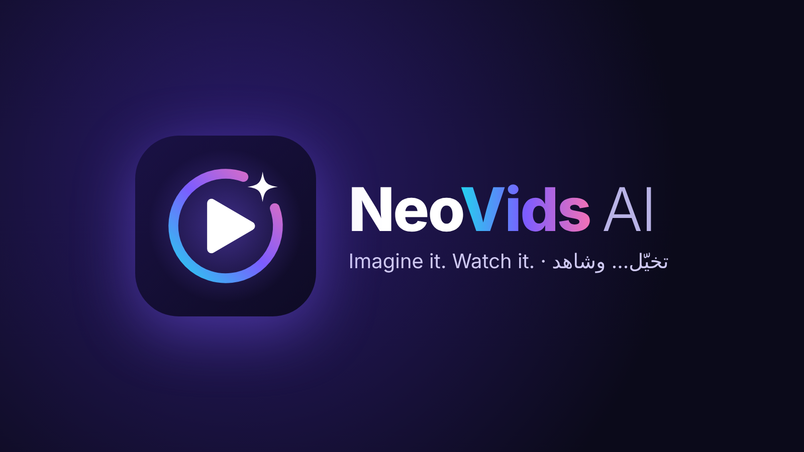

# NeoVids AI

استوديو فيديو وصور بالذكاء الاصطناعي على Android (Jetpack Compose)، بالعربية والإنجليزية.

- **نص إلى فيديو، صورة إلى فيديو، نص إلى صورة، تعديل الصور بالكلمات.**
- **الوصف الذكي:** يترجم الخادم وصفك العربي إلى الإنجليزية ويضيف الإضاءة وحركة الكاميرا والأسلوب قبل التوليد.
- **«حسّن بالذكاء» و«فاجئني»:** كاتب أوامر محترف وأفكار جديدة بلمسة.
- **مولّد صور مجاني مدمج** (Cloudflare Workers AI) يعمل حتى لو نفد رصيد المزوّدين المدفوعين.
- **صانع القصص:** فكرة واحدة ← مشاهد يكتبها المخرج الذكي ← فيديو لكل مشهد ← فيلم واحد مدمج.
- **استكشف:** 20 قالبًا جاهزًا (إعلانات، طبيعة، تراث عربي، سينما، أنمي…).
- **نسخ متعددة** للصور (حتى 4)، و**جودة احترافية** للفيديو (Kling) للمالك، و«حرّك الصورة» و«عدّل» من المكتبة.
- **محرّر:** قص ودمج، نص على الفيديو، فلاتر، سرعة، وموسيقى خلفية.
- بحث ومفضلة في المكتبة. النشر على Google Play: `docs/publishing.md`، سياسة الخصوصية: `docs/privacy.md`.
- مكتبة بشبكة صور مصغّرة، متابعة في الخلفية مع إشعار، حفظ ومشاركة، «أعد الإبداع» و«أعد المحاولة»، ومحرّر قصّ ودمج.

## تحميل التطبيق
من الهاتف مباشرة: https://github.com/Momohfbb/NeoVidsApp/releases/download/latest/app-debug.apk

التطبيق متصل تلقائيًا بالخادم الرسمي، لا حاجة لأي إعداد.

## البناء
كل دفع إلى `main` يبني الـ APK في GitHub Actions وينشره في الرابط أعلاه، وينشر الخادم (`backend/`) إلى Cloudflare ويختبره.
محليًا: `./gradlew assembleDebug` (Java 17 و Android SDK 35).

## الهوية البصرية
الشعار: `docs/logo.svg` (مدار الذكاء حول زر التشغيل، مع شرارة الإبداع). الألوان: بنفسجي `#7C5CFF`، سماوي `#22D3EE`، وردي `#F472B6`، ليلي `#0E0B24`.
